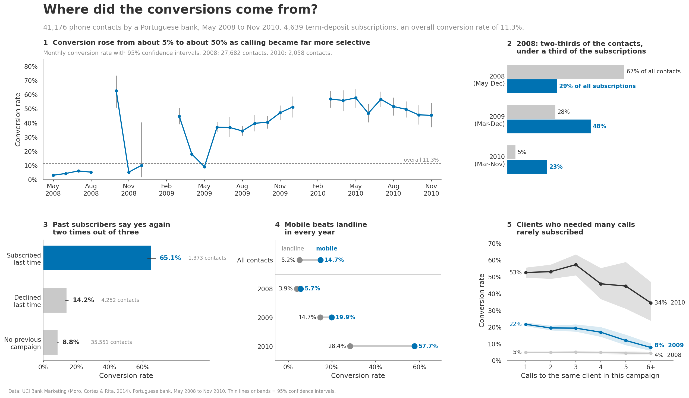
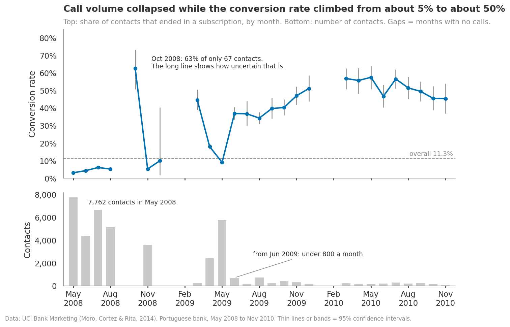
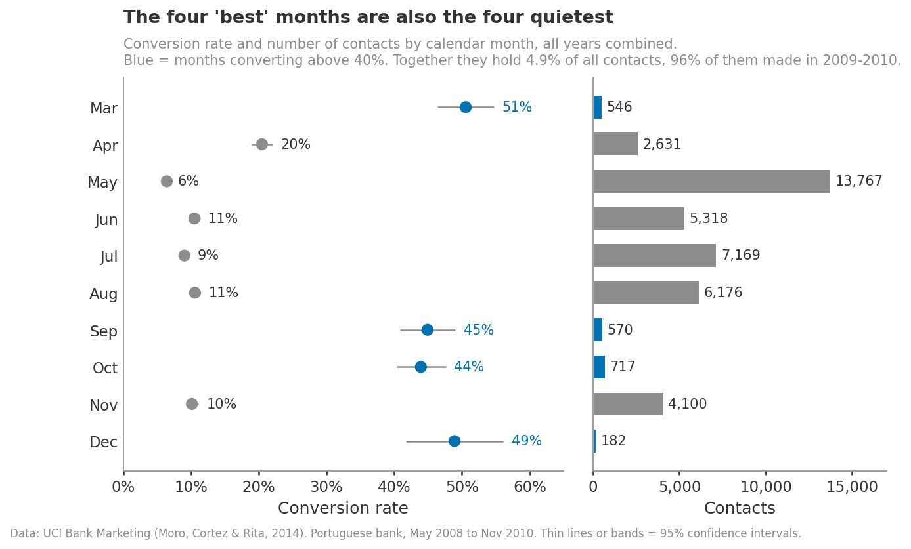
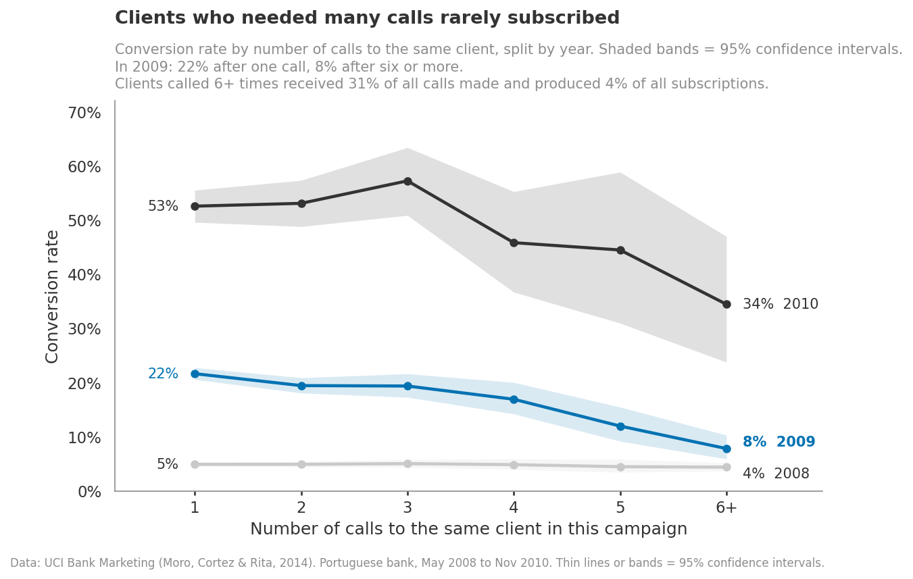
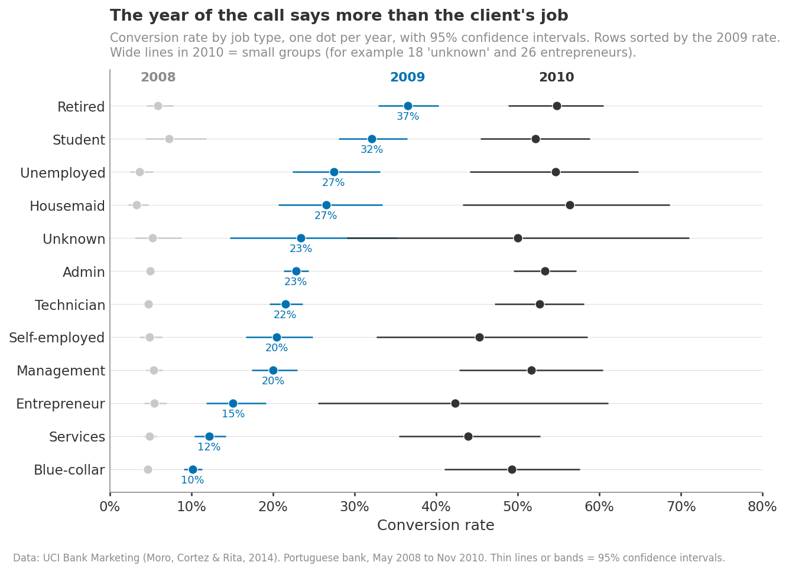
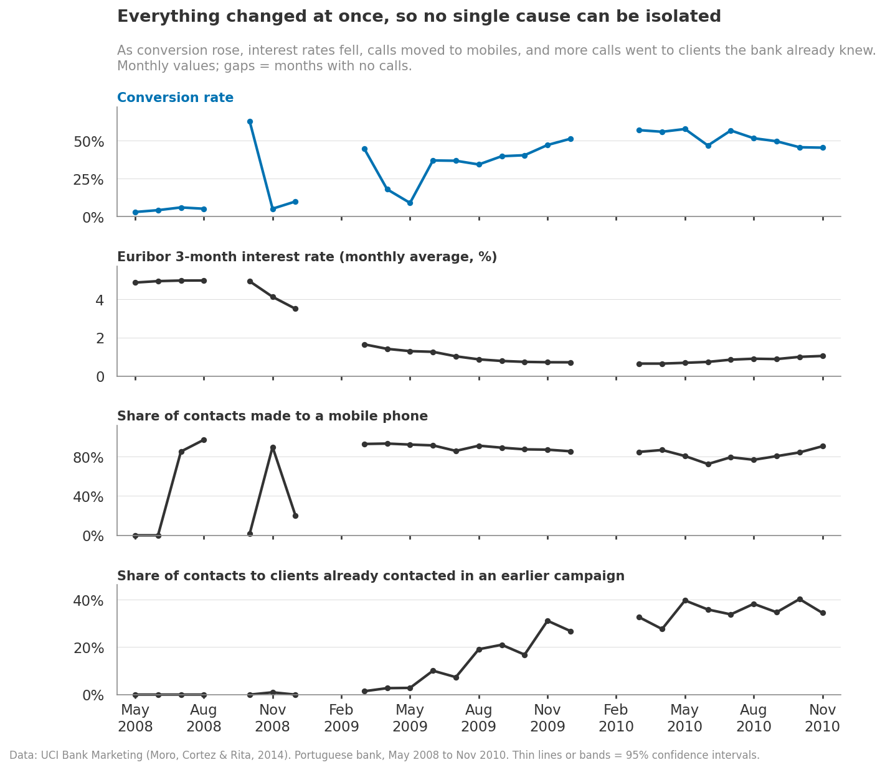

# Where do our conversions come from? A visual analysis of bank phone campaigns

**Skills shown:** data visualisation in Python (matplotlib, seaborn), chart selection, visual design, honest reading of observational marketing data.



## Business question

A marketing manager at a retail bank asks:

> "Where do our conversions actually come from, and what should we change in the next campaign?"

This project answers with a visual story of ten charts built on 41,176 real phone contacts made by a Portuguese bank between May 2008 and November 2010. Each contact either ended in a term-deposit subscription (a conversion) or did not.

## The answer up front

Overall, 4,639 of 41,176 contacts ended in a subscription: a conversion rate of **11.3%**. Behind that average:

1. **Timing dominates everything else.** The conversion rate was 4.8% in 2008, 19.5% in 2009 and 52.1% in 2010, while the number of contacts fell from 27,682 to 11,436 to 2,058. The year 2008 took 67% of all contacts and delivered 29% of all subscriptions; 2010 took 5% of the contacts and delivered 23%.
2. **Previous subscribers are the strongest segment.** Clients who subscribed in the previous campaign converted at 65.1% (894 of 1,373), against 8.8% for clients with no previous campaign. The gap holds within 2009 (56.8% vs 18.7%) and within 2010 (77.0% vs 44.8%).
3. **Mobile contacts convert better than landline contacts in every year,** but the pooled gap (14.7% vs 5.2%) overstates it. Within 2008 it was 5.7% vs 3.9%; within 2009, 19.9% vs 14.7%; within 2010, 57.7% vs 28.4%.
4. **Persistence has a poor return.** Clients called six or more times received 30.6% of all calls made and produced 4.0% of all subscriptions. 88.0% of subscriptions came from clients called at most three times.
5. **Calendar month, age and job look powerful in simple tables but mostly stand in for the period.** The four "best" months (March, September, October, December: 44-51%) hold only 4.9% of all contacts, 96% of them made in 2009-2010. Within 2008 and within 2010, age and job make little difference.

These are associations in observational data, not proven causes. See [Limitations](#limitations).

## Selected charts

### Rate and volume, shown together



Call volume collapsed while the conversion rate climbed. Showing both on one time axis stops the reader from being impressed by a high rate that rests on very few calls: October 2008 shows 63%, but from only 67 contacts, and the long interval line makes that visible.

### The "best months" are the quietest months



A table of rates alone would say "call in March and December". The volume bars show why that is not a safe conclusion: those months have very few contacts, almost all from the high-converting years. This data cannot confirm or rule out a seasonal effect.

### Repeat calls



In 2009 the conversion rate fell from 21.6% for clients reached with one call to 7.8% for clients called six or more times. In 2008 it was about 5% however often the client was called. This does not prove that extra calls reduce interest (clients who are easy to convince say yes early and leave the list), but the later calls bought very few subscriptions.

### The period matters more than the profile



For every job type, the three yearly dots are further apart than the jobs are from each other within a year. Only 2009 separates jobs clearly: retired clients (36.5%) and students (32.1%) at the top, services (12.2%) and blue-collar workers (10.1%) at the bottom.

### Why no single cause can be named



Contacts made while the Euribor interest rate was below 2% converted at 24.5%, those made at 2% or above at 4.8%. But over the same months the bank also moved to mobile phones, cut volume sharply and increasingly called clients it already knew. These changes are tangled together in time, so their separate effects cannot be measured from this data.

The notebook contains five more charts (share of contacts vs subscriptions by year, mobile vs landline, previous campaign outcome, age bands, call duration), each with its question and takeaway.

## Recommendations for the marketing team

1. **Start every campaign with previous subscribers.** This is the largest and most stable difference in the data (65.1% vs 8.8%), and it holds within years.
2. **Set a cap on calls per client, for example three or four, and test it.** Clients called six or more times absorbed 30.6% of the calls for 4.0% of the subscriptions. A cap would free agent time for new clients.
3. **Prefer mobile numbers where both are available,** while recording the channel so the advantage can be re-measured. It appears in all three years, but the data cannot say whether the channel or the type of client behind it drives the difference.
4. **Do not plan the calendar around the "best months" in this data.** The monthly pattern is produced by when the small, selective campaigns happened to run. If seasonality matters, test it: run comparable call lists in different months.
5. **Treat age and job as leads to test, not as rules.** Retired clients, students, the under-25s and the over-65s responded best in 2009, but not visibly in 2008 or 2010.
6. **Build measurement into the next campaign.** A randomly chosen control group (for example, a random part of the list that receives the old approach) is the only way to separate the effect of targeting from the effect of the economic climate.
7. **Do not use call length for targeting.** Successful calls were longer (median 7.5 minutes vs 2.7), but call length is only known after the call. It is useful for staffing estimates only.

## Data

| | |
|---|---|
| Dataset | Bank Marketing (with social/economic context), file `bank-additional-full.csv` |
| Source | UCI Machine Learning Repository, dataset 222: https://archive.ics.uci.edu/dataset/222/bank+marketing |
| Licence | Creative Commons Attribution 4.0 International (CC BY 4.0) |
| Size | 41,188 rows, 21 columns; 41,176 rows after removing 12 exact duplicates |
| Period | May 2008 to November 2010, one Portuguese retail bank |

Citation: Moro, S., Cortez, P. and Rita, P. (2014). A data-driven approach to predict the success of bank telemarketing. *Decision Support Systems*, 62, 22-31.

The data dictionary is in [`data/README.md`](data/README.md). The data is real and unchanged; nothing was simulated or imputed.

### Preparation decisions

- **Duplicates:** 12 rows identical in all 21 columns were removed.
- **Missing values:** stored as the text "unknown". Kept as their own category, not imputed.
- **`pdays` = 999** means "never contacted before". It was turned into a yes/no column (`contacted_before`) instead of being treated as a number.
- **Year:** the file has no year column, but the rows are in date order. The year was rebuilt by starting a new year whenever the month goes backwards. Checked: the result runs from May 2008 to November 2010 across 26 months, and the four monthly or quarterly economic indicators take exactly one value inside every rebuilt month.
- **Uncertainty:** conversion rates are shown with 95% Wilson confidence intervals, so small groups are visibly less certain.

## Method and design choices

- One question per chart, and a title that states the finding.
- One accent colour (blue) for what the reader should look at, greys for context. The blue-on-grey scheme stays readable for colour-blind readers and in greyscale.
- Direct labels instead of legends, sorted categories, percentages and thousands separators, no decorative elements.
- Rates are never shown without their volume or their confidence interval.
- Where a pooled comparison would mislead, the chart is split by year (channel, repeat calls, age, job).

## How to run

Requires Python 3.10 or newer.

```
pip install -r requirements.txt
jupyter notebook notebooks/01_campaign_visual_analysis.ipynb
```

Or open the notebook in VS Code and choose "Run All". The notebook reads `data/bank-additional-full.csv` through a relative path and rewrites all images in `images/`. It needs no internet connection and runs in under a minute.

## Project structure

```
bank-marketing-campaign-visuals/
  README.md
  requirements.txt
  notebooks/01_campaign_visual_analysis.ipynb   executed, with outputs
  data/bank-additional-full.csv                 raw data (5.8 MB)
  data/bank-additional-names.txt                official notes from the authors
  data/README.md                                data dictionary
  images/                                       ten charts and the summary figure (150 dpi PNG)
```

## Limitations

- **Observational data.** Nobody assigned clients at random to a channel, a month or a number of calls. All findings are associations. The bank's own choices about whom to call, and when, are part of every pattern.
- **Confounding in time.** Interest rates, channel mix, call volume and the share of previously contacted clients all changed together. Splitting by year reduces the problem but does not remove it, because conditions also changed within each year.
- **One bank, one country, one unusual period.** The data covers Portugal during the 2008-2010 financial crisis. Term-deposit demand at that time may not resemble today's market or another product.
- **Reconstructed year.** The year is inferred from row order. The consistency checks pass, but it remains an inference.
- **Small groups.** Some cells are small (for example 67 contacts in October 2008, or 61 clients called six or more times in 2010). Confidence intervals are shown for that reason, and they describe sampling uncertainty only, not bias.
- **Pooled figures can reverse.** Clients who declined in the previous campaign convert better than new clients in the pooled data (14.2% vs 8.8%) but worse within every single year (2008: 3.4% vs 4.9%; 2009: 12.9% vs 18.7%; 2010: 34.6% vs 44.8%). This is Simpson's paradox and a warning for all pooled comparisons in this dataset.
- **Data quirks.** 4,110 rows have a previous outcome of "failure" but `pdays` = 999 ("never contacted"); the official notes do not explain this. Each row records only the last contact with a client in a campaign, so the outcome of earlier calls to the same client is not visible.
- **`duration`** is known only after the call and is shown for description only.
